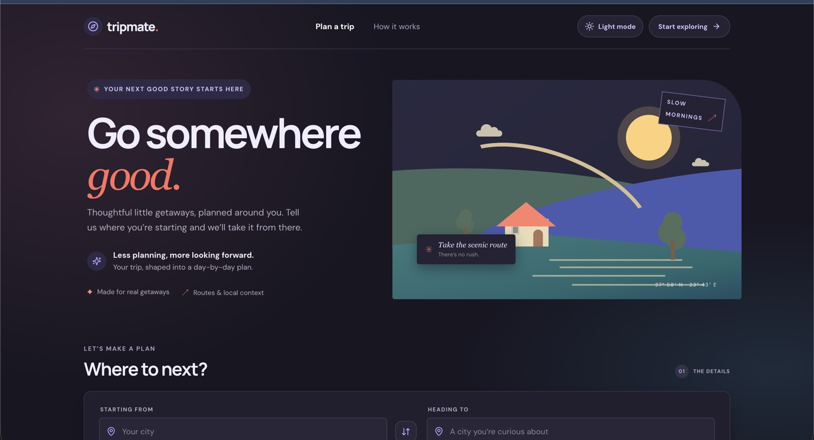
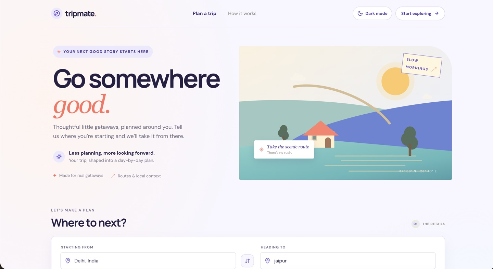
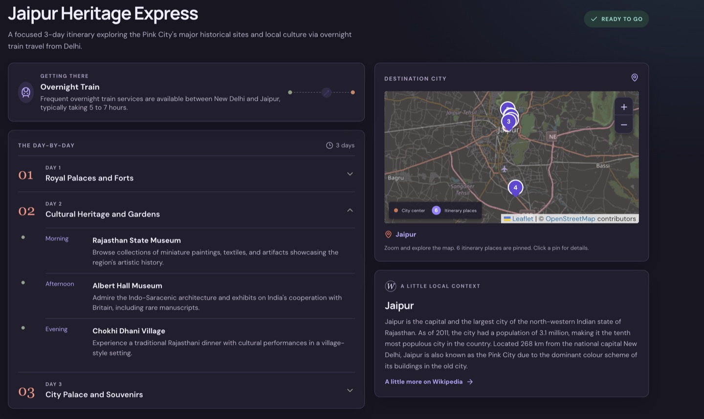

# TripMate

Plan a thoughtful city getaway around your dates, budget, interests, and travel style. TripMate builds a day-by-day itinerary, suggests how to get there, and gives you a destination map and local context.

**[Open the live app](https://tripmate-elo3.onrender.com/)**

## Screenshots

Screenshots from the app, in light and dark mode, plus an example itinerary.

<div align="center">
  
  
  <p><em>Plan a trip in dark or light mode.</em></p>
  
  <p><em>A generated itinerary, destination map, and local context.</em></p>
</div>

## What it does

- Builds trips of 1–10 days from a starting city, destination, and departure and return dates.
- Plans for groups of 1–12 travelers, with an optional total budget in Indian rupees. The budget breakdown covers travel, stay, food, shopping, and activities.
- Uses travel style, intercity and local transport choices, interests, and family-friendly preferences to shape the itinerary.
- Suggests cities as you type. Suggestions support keyboard navigation and show location details to help distinguish cities with the same name.
- Creates a chronological itinerary with a pace that reflects the selected travel style, groups nearby stops, and keeps arrival days practical.
- Recommends intercity travel and local transport, with estimated departure and arrival windows when available.
- Shows a destination map with itinerary stops, day filters, neighborhood groups, and estimated walking or driving routes. Directions can open in Google Maps.
- Adds a short Wikipedia summary when one is available.
- Prints or saves the itinerary as a PDF without including the city map.

## Run locally

1. Install Node.js 20 or newer.
2. Copy `.env.example` to `.env` and add a Groq API key from [GroqCloud](https://console.groq.com/keys).
3. Install dependencies and start the client and API server:

   ```sh
   npm ci
   npm run dev
   ```

4. Open the Vite address shown in the terminal, usually `http://localhost:5173`.

The Groq key is read only by the Express server. Do not put it in a `VITE_` variable or commit `.env`. The default model is `qwen/qwen3.8-27b`; set `GROQ_MODEL` to use another model. `AI_TIMEOUT_MS` adjusts the request timeout (default 60 seconds, capped at 120 seconds).

For a production build, run `npm run build`, then start the server with `NODE_ENV=production npm start`. The Render deployment configuration is in [`render.yaml`](render.yaml).

## Services and limits

- Groq generates and validates the itinerary.
- Photon provides debounced city suggestions; OpenStreetMap/Nominatim resolves the final city locations.
- Leaflet displays OpenStreetMap tiles. The public Valhalla demo estimates routes and may rate-limit or be unavailable; route links remain available if estimates fail. Do not use these estimates as live navigation.
- Wikipedia provides optional destination context.
- TripMate caches itinerary requests in memory for 30 minutes to reduce duplicate generation. The cache resets when the server restarts.

Public community services have availability and fair-use limits. Google Maps opens only when a traveler selects a directions link; TripMate does not call a paid Google Maps API.

## Checks

```sh
npm run check
```

This runs formatting validation, ESLint, TypeScript validation, all tests, and a production build. It is also run by the Git pre-push hook and GitHub Actions.

## Code layout

- `src/components/App/App.tsx` coordinates planner state, service calls, and itinerary state.
- `src/components/AppContent/AppContent.tsx` composes the planner and results views.
- `src/components/` contains the planner controls and reusable itinerary, map, and budget cards. Component tests and types live beside their components.
- `src/constants/` and `src/utils/` hold form defaults, options, formatting, date, budget, and preference helpers.
- `src/services/travel.js` integrates the external travel and location services.
- `server/` validates requests, caches generated plans, and builds the itinerary prompt.
